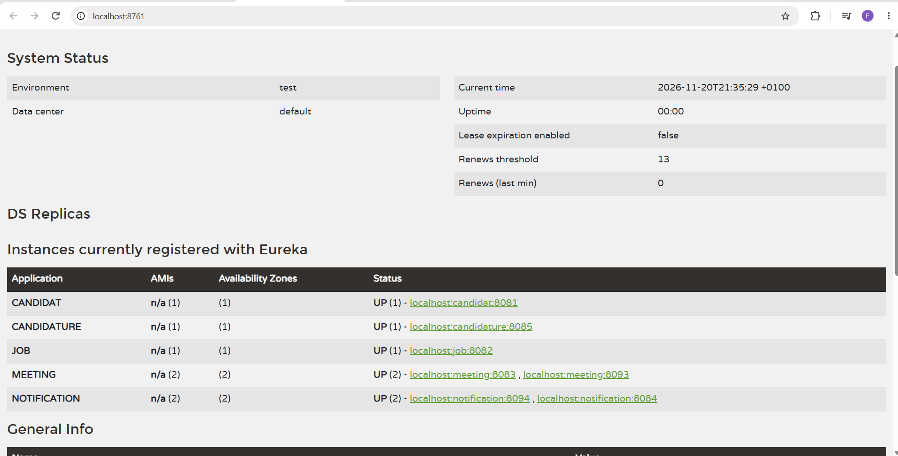
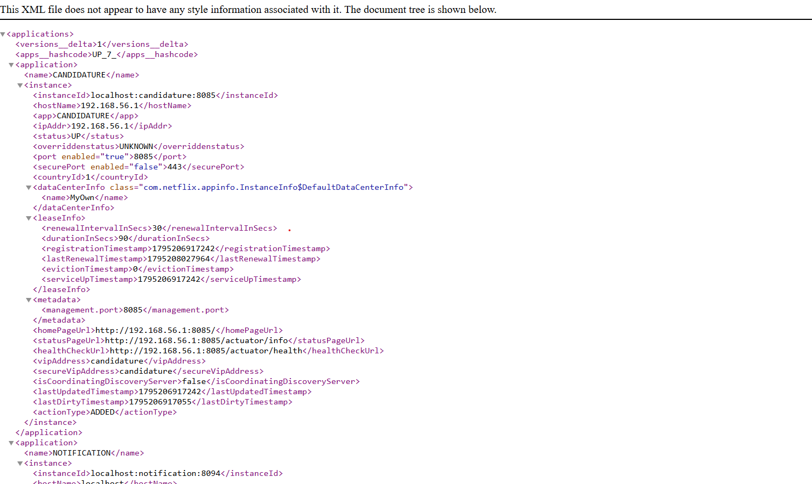
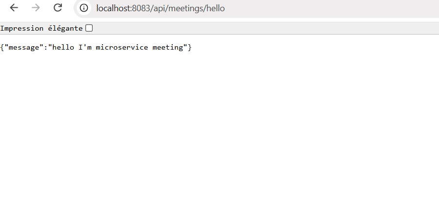
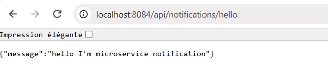
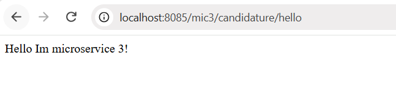

# Projet Eureka – Architecture Web Distribuée (ESPRIT 2026-2027)

## Équipe
- Boussaada Fatma
- sliti jihen

## Architecture

| Microservice | Technologie | Port | Nom dans Eureka | Dossier |
|---|---|---|---|---|
| Eureka Server | Spring Boot | 8761 | – | `backend/eureka` |
| Candidat | Spring Boot + H2 | 8081 | CANDIDAT | `backend/microservices/candidat` |
| Job | Spring Boot + MySQL | 8082 | JOB | `backend/microservices/job` |
| Meeting | Node.js / Express | 8083 | MEETING | `backend/microservices/meeting` |
| Notification | Python / FastAPI | 8084 | NOTIFICATION | `backend/microservices/notification` |
| Candidature | Spring Boot | 8085 | CANDIDATURE | `backend/microservices/canditature` |

## Prérequis
Java 17, Maven, Node.js >= 18, Python >= 3.10, MySQL (pour Job, script `backend/microservices/job/database/job_db.sql`).

## Lancement (Windows)
Les scripts sont dans le dossier `scripts/` :

1. `scripts\1-start-eureka.bat` puis ouvrir http://localhost:8761
2. `scripts\2-start-services.bat` (Candidat, Job, Candidature, Meeting, Notification)
3. `scripts\3-start-second-instances.bat` (2e instance de Candidat 8091, Meeting 8093, Notification 8094)

### Lancement manuel (PowerShell)
```powershell
# Eureka
cd backend/eureka; mvn spring-boot:run

# Candidat / Job / Candidature
cd backend/microservices/candidat; mvn spring-boot:run
# 2e instance de Candidat (autre terminal)
mvn spring-boot:run "-Dspring-boot.run.arguments=--server.port=8091"

# Meeting (Node.js)
cd backend/microservices/meeting; npm install
$env:PORT=8083; npm start      # 1re instance
$env:PORT=8093; npm start      # 2e instance (autre terminal)

# Notification (Python) : PORT et --port doivent avoir la même valeur
cd backend/microservices/notification; pip install -r requirements.txt
$env:PORT=8084; python -m uvicorn app.main:app --port 8084    # 1re instance
$env:PORT=8094; python -m uvicorn app.main:app --port 8094    # 2e instance (autre terminal)
```

## Vérification
- Dashboard : http://localhost:8761
- http://localhost:8083/api/meetings/hello
- http://localhost:8093/api/meetings/hello
- http://localhost:8084/api/notifications/hello
- http://localhost:8094/api/notifications/hello
- http://localhost:8085/mic3/candidature/hello

## Capture du dashboard Eureka
CANDIDAT, JOB, CANDIDATURE, MEETING (x2) et NOTIFICATION (x2) visibles en même temps :



### Autres captures

**API REST d'Eureka (`/eureka/apps`)**



**Endpoints hello**



